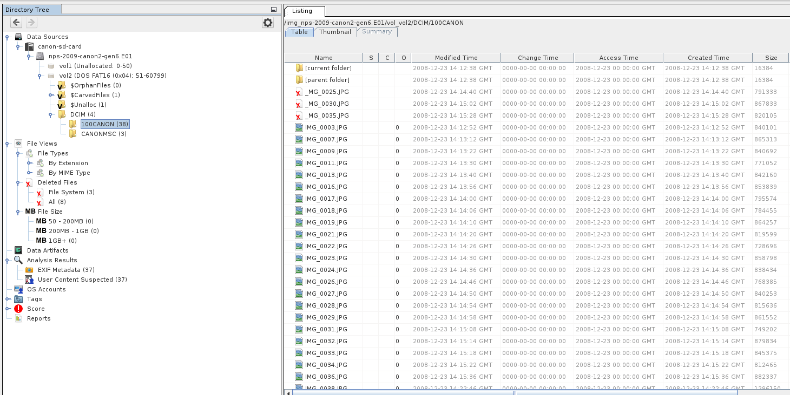

# Fedora Forensics Workstation

A documented digital forensics workstation built on Fedora Linux, used for
learning disk forensics with open source tools on public test images.

## Purpose

I am a second year Computer Forensics and Security student at SETU Waterford.
This repo records how I built my forensics workstation, why I chose each tool,
and worked examples on public datasets, written up the way I would write up
a real case.

## Cases

| Case | Image | What I found |
| --- | --- | --- |
| [001](case-001/README.md) | Canon SD card, Digital Corpora | 37 of 51 photos recovered (33 live, 4 carved), checked against the published narrative. 3 deleted entries found, content overwritten |

## Hardware and host

| Item | Detail |
| --- | --- |
| Laptop | ASUS Vivobook 16 (X1605V), Intel i7 13620H, 24 GB RAM |
| Host OS | Fedora 44 |
| Virtualisation | KVM with virt-manager |
| Case storage | Internal SSD, `~/projects/forensics/evidence/`, kept outside this repo |
| Test media | 16 GB USB sticks, wiped and used only for practice imaging |

## Toolkit

| Tool | Version | Used for |
| --- | --- | --- |
| The Sleuth Kit | 4.15.0 | Command line file system analysis |
| Autopsy | 4.22.1 | GUI case management, ingest modules, carving |
| ewftools | 20140608 | Reading and verifying E01 images |
| wxHexEditor | 0.24 | Checking file signatures and raw bytes by hand |
| sha256sum and md5sum (coreutils) | Fedora 44 package | Hashing images before and after analysis |
| Kali Linux VM | Rolling | Disposable environment for other tools |
| Windows 11 VM | 25H2 | Windows only tools and test artefacts |

Install steps, versions and the reasons behind each choice are in [docs/setup.md](docs/setup.md).

## What is in this repo

| Path | Contents |
| --- | --- |
| `docs/setup.md` | Every tool installed, how, and why |
| `case-001/` | Worked example on a public SD card image |
| `screenshots/` | Screenshots referenced in the write ups |

## Rules I work to

* Public datasets only. No real case data, ever.
* Every image is hashed before and after analysis.
* Evidence files are never committed to this repo.
* All times are recorded in UTC.

## Next steps

* Document my write blocking approach and test it on a USB stick
* Add evidence handling notes: naming, hashing, storage
* Case 002: image and analyse a practice USB stick
* Case 003: a NIST CFReDS image
* Add a Windows artefact example from the Windows VM

## Licence

Text and screenshots are mine. Scripts, when added, are MIT licensed. The test images belong to their publishers and are not included here.
