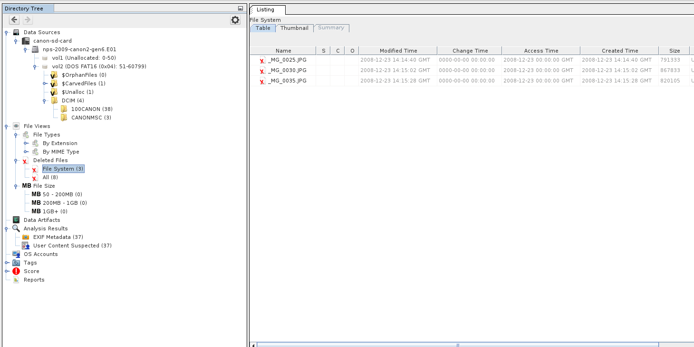
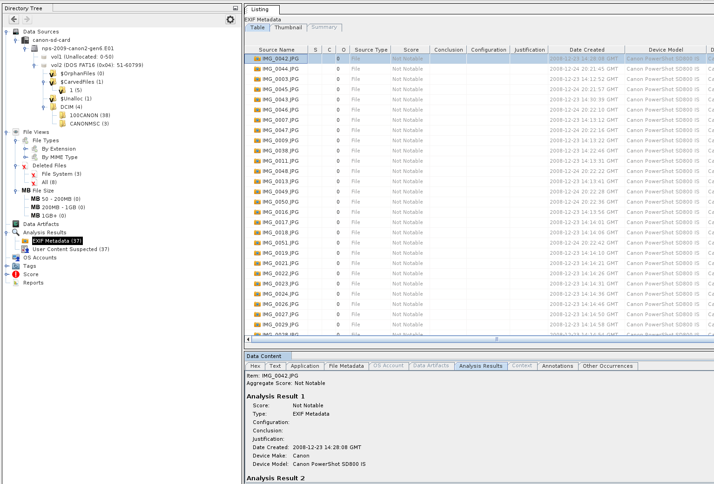
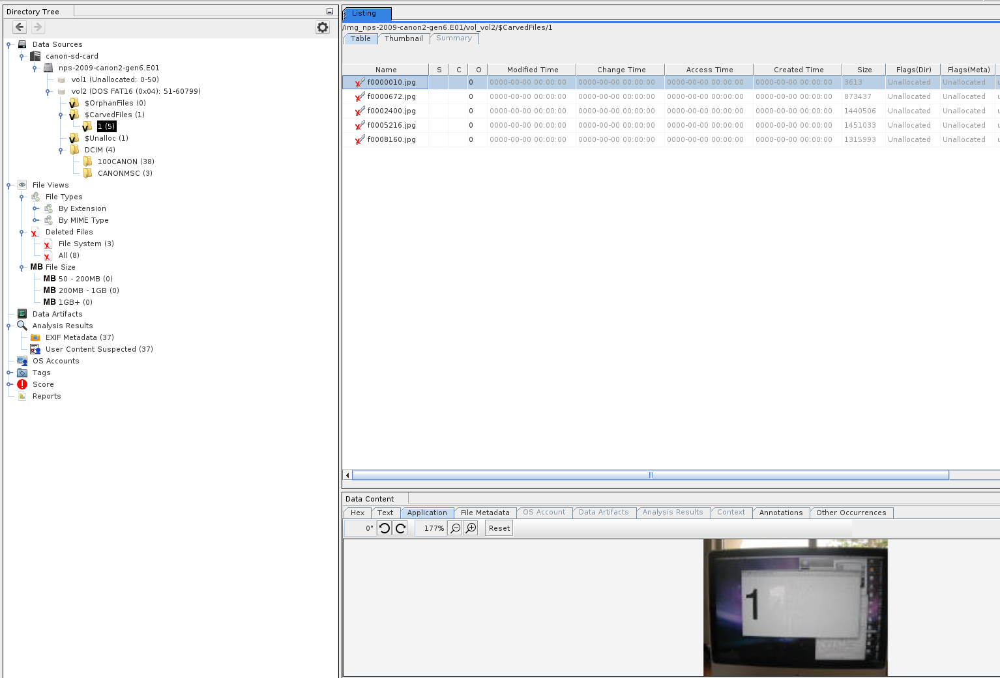

# Case 001: Canon SD card (public test image)

## Summary

Examined a public test image of a 32 MB SD card from a Canon PowerShot
SD800 IS camera to identify live, deleted and recoverable photos. Found
33 live JPEGs, 3 deleted directory entries whose content has been
overwritten, and 5 files carved from unallocated space, of which 4 are
full photos. In total 37 of the 51 photos were recovered.

## Source

| Item | Detail |
| --- | --- |
| Image | nps-2009-canon2-gen6.E01 |
| Origin | Digital Corpora, public research dataset |
| Downloaded | 2026-10-02 10:16:13 UTC |
| Format | EnCase 6 (E01) |
| Media size | 31,129,600 bytes (60,800 sectors of 512 bytes) |
| SHA256 of file | 10483722d84e0cefcb693b11dea2d32dbd3ad2f06f8c9656688c8c730fe41579 |
| Stored MD5 | 750b509d8fbed37a5213480aaccfdc61, verified with ewfverify |

## Tools

Autopsy 4.22.1 (with its PhotoRec Carver ingest module), The Sleuth Kit 4.15.0, ewftools 20140608, on Fedora 44.

## Evidence log

| # | Time (UTC) | Action | Tool | Result |
| --- | --- | --- | --- | --- |
| 1 | 10:16 | Downloaded image and narrative | curl | 29.7 MB E01 |
| 2 | 10:16 | Hashed image | sha256sum, md5sum | SHA256 recorded above |
| 3 | 10:16 | Verified stored hash | ewfverify | SUCCESS |
| 4 | 10:23 | Read partition table | mmls | One partition, sectors 51 to 60799 |
| 5 | 10:23 | Read file system details | fsstat | FAT12, label CANON_DC |
| 6 | 10:23 | Listed files including deleted | fls | 3 deleted entries |
| 7 | 10:45 | Created case, ran ingest | Autopsy | Data Source Integrity passed |
| 8 | 10:55 | Reviewed live, deleted and carved files | Autopsy | See findings |
| 9 | 11:15 | Reviewed EXIF metadata | Autopsy | 37 results |
| 10 | 11:29 | Hashed image after analysis | sha256sum | MATCH, image unchanged |

## Findings

1. **File system:** the partition table labels the partition FAT16
   (type 0x04), but the boot sector shows the file system is FAT12, volume
   label CANON_DC, OEM name PwrShot. The partition type is only a label;
   the boot sector is what defines the file system.
2. **Live files:** 33 JPEGs in `DCIM/100CANON`.
3. **Deleted files:** 3 entries, `_MG_0025.JPG`, `_MG_0030.JPG` and
   `_MG_0035.JPG`. FAT deletion overwrites the first character of the file
   name, which is why they appear with `_MG_` instead of `IMG_`. The
   directory entries survive with their names, sizes and times, but the
   content does not. Extracting each with `icat` gives data of the right
   size that is not a JPEG: it has no JPEG signature and exiftool reports
   a format error. `istat` gives the start sectors 39437, 47469 and 55629,
   and `ifind -d` and `blkstat` show those blocks are unallocated and no
   live file owns them. The clusters were reused by later photos that were
   themselves deleted: the carved files (IMG_0040 and IMG_0041, see
   Verification) now sit on top of them.
4. **Carved files:** 5 files recovered from unallocated space by PhotoRec,
   with no names or timestamps because no file system entry remained.
   One is only 3,613 bytes and is likely a thumbnail or fragment. The
   other four are full photos. `f0000672` is 1600x1200 while the others
   are 2048x1536, so IMG_0014 was taken at a lower resolution setting.
5. **Metadata:** EXIF shows every photo came from a Canon PowerShot
   SD800 IS. Most were taken on 23 Dec 2008 between 14:12 and 14:30.
   IMG_0044 to IMG_0051 were taken on 24 Dec 2008 between 20:21 and 20:22,
   a separate later session. Autopsy reports 37 EXIF results: 33 live
   photos plus 4 carved photos. The 3,613 byte preview has none, and the
   deleted entries have none because their content is gone.
6. **Timestamps:** FAT stores local time with no time zone. Autopsy shows
   them as GMT, but the true offset is unknown. Separately, ewfinfo
   displays the acquisition time in the examiner's local time zone, so
   the same image shows different times on different machines. All times
   in this log are recorded in UTC for that reason.

## Verification

Compared my findings with the dataset's published narrative, which lists
51 photos taken over six generations of the card (IMG_0001 to IMG_0051),
each a photo of a screen showing its number.

* The 4 full size carved photos show "14", "G2-3", "G2-4" and "G3-1",
  which the narrative identifies as IMG_0014, IMG_0039, IMG_0040 and
  IMG_0041. All four open as complete images. Their EXIF times fit between
  their neighbouring live photos:

| Carved file | Capture time (camera clock) | Photo | Between |
| --- | --- | --- | --- |
| f0000672 | 14:13:45 | IMG_0014 | IMG_0013 and IMG_0016 |
| f0002400 | 14:22:54 | IMG_0039 | IMG_0038 (14:22:46) and IMG_0042 (14:28:08) |
| f0005216 | 14:23:01 | IMG_0040 | IMG_0038 and IMG_0042 |
| f0008160 | 14:26:13 | IMG_0041 | IMG_0038 and IMG_0042 |

* The 3,613 byte carved file shows "1". It is a small preview of
  IMG_0001, not the full photo.
* In total I recovered 37 of the 51 photos as full images: 33 live and
  4 carved. The other 14 were not recovered, including the full IMG_0001
  and the three photos behind the deleted entries. The most likely reason
  is that later photos overwrote their data.
* The narrative notes that some photos are fragmented. Carving rebuilds
  a file from one continuous run of data, so a fragmented photo with no
  file system entry left is very hard to recover this way.

## What I learned

* A deleted entry is not a deleted file. Check the content before
  calling it recoverable. FAT keeps the directory entry, but the clusters
  can be reused. Content that survives in unallocated space can still be
  carved.
* Verify the image twice: once with ewfverify, once inside the tool.
* Record times in UTC and note where a tool is assuming a time zone.

## Screenshots

**File tree: DCIM/100CANON holds 38 entries: 33 live photos, 3 deleted entries, and the current and parent folder entries.**

**Deleted files: The three entries FAT marked as deleted.**

**EXIF metadata: Camera model and capture time for each photo.**

**Carved files: The five files PhotoRec recovered from unallocated space. The selected 3,613 byte file is the preview of IMG_0001.**

## Correction

My first version counted the 3 deleted entries as recovered photos. Checking
the file signatures and cluster ownership showed their content had been
overwritten, so the total is 37 of 51, not 40.
